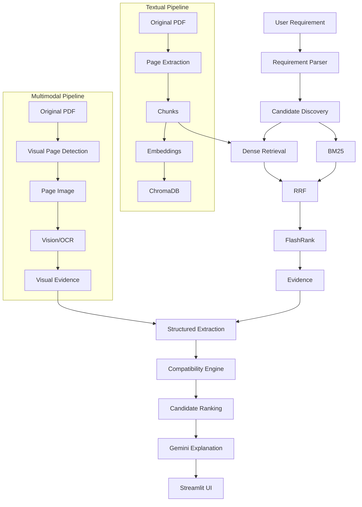

# SiliconSense RAG — Final Implementation Plan

## 1. Executive Summary
SiliconSense RAG is a production-oriented RAG and multimodal semiconductor datasheet intelligence system. It takes natural-language component requirements, retrieves authoritative manufacturer evidence, extracts structured specifications, deterministically evaluates compatibility, ranks candidates, and provides grounded explanations with page-level evidence.

## 2. Problem Statement
Evaluating semiconductor components across multiple datasheets is time-consuming and error-prone. Traditional RAG systems often hallucinate specifications or use LLMs to make deterministic engineering decisions, leading to unreliable and potentially disastrous hardware choices. 

## 3. Project Objective
Build an evidence-grounded system that strictly separates evidence retrieval, deterministic logic, and LLM explanation. The system must never allow an LLM to invent specifications or override Python-based deterministic compatibility rules.

## 4. Core Design Principle
- RAG retrieves evidence.
- Structured extraction converts evidence into specifications.
- Python deterministically evaluates compatibility.
- Python ranks candidates.
- Gemini explains the result.
- Evidence is always traceable to the original datasheet.

## 5. Dataset
The dataset consists of 10 official manufacturer datasheets from STM32 and ESP32 families located in `data/raw_datasheets/`. Original PDFs must remain untouched (no cropping or deleting).

## 6. Current Project Status
- Phase 0 (Setup): Completed. Environment, dependencies, and folder structure established.
- Phase 1 (PDF Ingestion): Completed. 10 PDFs processed resulting in 1358 pages and 3301 chunked text blocks stored as JSONL.

## 7. Final Architecture
The architecture is divided into the textual RAG pipeline and a staged multimodal visual pipeline, converging at the structured extraction and compatibility engine.

## 8. End-to-End Data Flow
1. **User Input:** Natural language requirement.
2. **Parsing:** Converted into structured constraints.
3. **Candidate Discovery:** Narrow catalog down to 3-5 candidates.
4. **Retrieval:** Dense search (ChromaDB) + BM25 keyword search per candidate.
5. **Fusion/Reranking:** RRF combines results, FlashRank reranks them.
6. **Extraction:** Relevant chunks passed for structured specification extraction.
7. **Evaluation:** Deterministic Python engine evaluates compatibility (PASS/FAIL/UNKNOWN).
8. **Ranking & Explanation:** Candidates ranked, Gemini generates human-readable grounded explanation.
9. **UI:** Results presented in Streamlit.

## 9. Visual Architecture

## 10. Internal Working of Each Box

**Dense Retrieval:**
- INPUT: User requirement / candidate query
- PROCESS: Embedding similarity search against ChromaDB
- OUTPUT: Top-k chunks + metadata
- WHY: Semantic retrieval of technical concepts.

**BM25:**
- INPUT: Query terms
- PROCESS: Keyword scoring
- OUTPUT: Exact-match results
- WHY: To reliably retrieve technical identifiers (e.g., STM32F401RE, LQFP48).

**RRF (Reciprocal Rank Fusion):**
- INPUT: Dense rankings + BM25 rankings
- PROCESS: Rank fusion using formula 1/(60+rank)
- OUTPUT: Combined ranking
- WHY: Hybrid retrieval merging semantics and exact keywords.

**FlashRank:**
- INPUT: RRF candidates
- PROCESS: Cross-encoder style relevance reranking
- OUTPUT: Best evidence chunks
- WHY: To drastically improve evidence quality before extraction.

**Compatibility Engine:**
- INPUT: Structured requirement + structured component spec
- PROCESS: Deterministic rule checks in Python
- OUTPUT: PASS/FAIL/UNKNOWN per constraint
- WHY: Prevent LLM hallucination in strict engineering decisions.

**Gemini Explanation:**
- INPUT: Structured results + evidence
- PROCESS: Grounded explanation generation
- OUTPUT: Human-readable summary
- WHY: Make the technical result understandable without altering facts.

## 11. PDF Ingestion
Completed via PyMuPDF. Extracts page text safely without modifying original files.

## 12. Text Processing
Conservative text cleaning (whitespace normalization). Page-aware chunking targets ~900 characters with ~150 overlap, strictly enforcing page boundaries. Outputs JSONL.

## 13. Multimodal Processing
Staged pipeline. P0 relies on text. Future phases detect visual pages (diagrams, tables) using signals, render relevant pages, and use vision/OCR to generate structured visual evidence mapped to original page numbers.

## 14. Component Catalog
Pre-filtered metadata to prevent blindly retrieving across the entire database. Identifies top 3-5 candidates for deep RAG inspection.

## 15. Requirement Parsing
Deterministic Python parsing (`RequirementParser`) converts natural language to constraints in `RequirementSpec` (e.g., `min_flash_kb`, `voltage_max`, `part_number`). Handles unit normalization, contradiction detection, and defaults missing values to UNKNOWN. No LLM dependency.

## 16. Embeddings
Uses `sentence-transformers/all-MiniLM-L6-v2`. Local, free, and reproducible.

## 17. ChromaDB
Local persistent storage (`data/chroma_db/`) containing embeddings, chunk text, metadata (source, page, chunk ID). 

## 18. BM25
Uses `rank-bm25`. Built once and persisted to ensure exact matches on parts and interfaces.

## 19. Hybrid Retrieval
Combines Dense search (top ~15) and BM25 (top ~15) outputs before fusion.

## 20. RRF
Fuses retrieval rankings to produce a unified top ~10 evidence list per candidate.

## 21. FlashRank
Reranks the RRF candidates to select the final top 3-5 high-quality evidence chunks.

## 22. Structured Extraction
Pydantic schema (`ComponentSpec`) captures extracted values with strict evidence metadata attached. Uses deterministic extraction. Includes a component identity safeguard that filters out evidence from wrong components (e.g. F103C8 vs F411RE). "UNKNOWN" is heavily utilized for missing or conflicting data.

## 23. Compatibility Engine
Deterministic Python checking evaluates `RequirementSpec` against `ComponentSpec`. Uses strict rules for voltage overlap, memory thresholds, interface subsets, and package matching. Evaluates constraint-level PASS/FAIL/UNKNOWN statuses and resolves an overall status: FAIL > UNKNOWN > PASS. Hard constraints cannot be overridden by scores.

## 24. Candidate Ranking
Sorts candidates by satisfied constraints, numeric margins, and evidence quality. Employs a strictly enforced Hard Compatibility Gate where `POTENTIAL_MATCH > INSUFFICIENT_EVIDENCE > INCOMPATIBLE`. `INCOMPATIBLE` components are assigned `score = None` and can never outrank viable options. Soft scores are normalized 0-100.

## 25. Evidence & Citations
Every result maps directly back to PDF, Page, and Chunk ID.

## 26. Gemini
Uses `google-genai` SDK. Only summarizes and explains. Never calculates compatibility or invents specs.

## 27. LangSmith
Observability layer configured via environment variables. Tracks queries, latencies, and pipeline traces.

## 28. Evaluation
Honest evaluation on Recall@K, MRR, and end-to-end tests for PASS/FAIL/UNKNOWN.

## 29. Streamlit UI
Displays parsed requirements, candidate list, compatibility matrix, detailed evidence, transparency metrics, and Gemini explanation.

## 30. Testing Strategy
Deterministic unit tests for ingestion, extraction schemas, and compatibility logic.

## 31. Notebook-to-Production Refactor
Iterative development in `notebooks/ChipMatch_RAG_MVP.ipynb`, migrating stable components to `src/`.

## 32. Deployment Plan
Targeting Streamlit. Involves static persistence strategies, ChromaDB packaging, caching, and secure secrets management.

## 33. GitHub Structure
Includes `README.md`, `PLAN.md`, `.gitignore`, `.env.example`, `requirements.txt`.

## 34. Security
API keys stored exclusively in `.env`. Never exposed in code, logs, or UI.

## 35. Limitations
Does not claim guaranteed drop-in replacements unless absolute electrical/pinout evidence is extracted.

## 36. Future Multimodal Roadmap
Advanced pin-level and package-level comparison using vision models to compare visual pinout diagrams.

## 37. Final Implementation Phases
1. Phase 0 Setup (DONE)
2. Phase 1 PDF ingestion (DONE)
3. Phase 2 Embeddings (DONE)
4. Phase 3 ChromaDB (DONE)
5. Phase 4 BM25 (DONE)
6. Phase 5 Hybrid + RRF (DONE)
7. Phase 6 FlashRank (DONE)
8. Phase 7 Requirement parser (DONE)
9. Phase 8 Structured extraction (DONE)
10. Phase 9 Candidate ranking (DONE)
11. Phase 10 Evidence & citation trace (DONE)
12. Phase 11 Evaluation (DONE - preliminary)
13. Phase 12 Gemini grounded explanation (DONE - mock validated)
14. Phase 13 Streamlit UI (DONE)
15. Phase 14 LangSmith Observability (DONE)
16. Phase 15 Evaluation Dataset and Retrieval Quality (DONE)
17. Phase 16 Failure Analysis and Reliability (DONE)
18. Phase 17 Final UI and End-to-End Verification (DONE)
19. Phase 18 Security, Dependency and Repository Audit (DONE)
20. Phase 19 Deployment Preparation (DONE)
21. Phase 20 Production Monitoring and Operational Readiness (DONE)
22. Phase 21 CI, Regression Protection and Release (DONE)
23. Phase 22 Final Portfolio Quality (DONE)

## 38. Definition of Done
- [x] 10 official datasheets ingested
- [x] page-aware chunks validated
- [x] embeddings working
- [x] ChromaDB persistent
- [x] BM25 working
- [x] hybrid retrieval working
- [x] RRF working
- [x] FlashRank working
- [x] requirement parser working
- [x] structured extraction working
- [x] evidence mapping working
- [x] compatibility engine tested
- [x] PASS/FAIL/UNKNOWN tested
- [x] candidate ranking working
- [x] retrieval evaluation completed (preliminary 3 queries)
- [x] Gemini grounded explanation working (mock/offline validated)
- [x] Streamlit UI working
- [ ] multimodal evidence pipeline working for selected visual pages
- [x] LangSmith observability integrated or safely optional
- [x] unit tests passing
- [x] local end-to-end demo working
- [x] deployment-ready
- [x] README completed
- [x] PLAN.md completed
- [x] no secrets committed
- [x] no fake metrics
- [x] no unsupported compatibility claims
