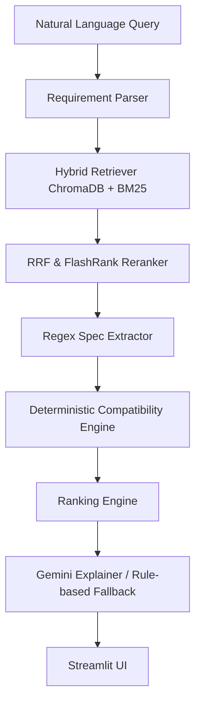

# SiliconSense RAG

**Evidence-Driven Semiconductor Component Intelligence**

A semiconductor datasheet RAG system combining hybrid retrieval, reranking, specification extraction, evidence citations, and deterministic component compatibility analysis.

## Problem Statement
Hardware engineers spend countless hours parsing dense, hundreds-of-pages-long PDF datasheets to evaluate component specifications. Existing LLM approaches hallucinate numbers or miss critical constraints. SiliconSense RAG solves this by strictly separating retrieval from evaluation: it uses RAG to find evidence, Python to deterministically evaluate compatibility, and Gemini solely to explain the proven results.

## Key Features
- **Deterministic Requirement Parsing:** Converts natural language queries into strict `RequirementSpec` objects.
- **Hybrid Retrieval Pipeline:** Combines Dense Vector Search (ChromaDB + SentenceTransformers) with Keyword Search (BM25).
- **Reciprocal Rank Fusion (RRF) & FlashRank:** Fuses and reranks chunks to select the absolute best evidence.
- **Traceable Citations:** Every extracted specification maps directly to a source PDF and exact page number.
- **Hard Compatibility Gate:** Components that fail a strict requirement cannot outrank those that pass.
- **LangSmith Observability:** Full tracing of latencies, retrieval chunks, and LLM calls.
- **Streamlit UI:** A clean, professional UI built for engineering screening.

## Architecture



**End-to-End Pipeline Workflow:**
1. **PDF Extraction:** PyMuPDF parses raw datasheets.
2. **Page-Aware Chunking:** Text is chunked while retaining page-level metadata.
3. **Local Embeddings:** `sentence-transformers/all-MiniLM-L6-v2` embeds chunks.
4. **Hybrid Retrieval & Reranking:** BM25 and ChromaDB fetch top candidates, fused via RRF, and reranked using FlashRank.
5. **Extraction & Compatibility:** Python regex extracts specifications. A deterministic compatibility engine evaluates them against the parsed requirements.
6. **Explanation:** Gemini (or a deterministic fallback) summarizes the results.

⚠️ **Core Architectural Rule:** LLMs are strictly forbidden from making engineering decisions or extracting specifications. RAG retrieves evidence, Python evaluates compatibility, and Gemini explains the computed result.

## Evaluation Methodology & Results
Evaluated against 15 manually constructed, highly complex engineering queries:
- **Hit Rate@5:** 93.3% (The RAG retrieval pipeline successfully locates the correct text chunk).
- **Extraction Accuracy:** Flash (1/15), SRAM (2/15), Voltage (2/15).
  *Note on Extraction:* The system is designed to be extremely strict. Because dense PDF tables often contain conflicting family data (e.g. "STM32F103x8 features 64KB, STM32F103xB features 128KB"), the deterministic engine detects conflicts and safely assigns `UNKNOWN` rather than hallucinating. 

## Installation & Setup

1. Clone the repository:
   ```bash
   git clone https://github.com/SaiSourav2004/siliconsense-rag.git
   cd siliconsense-rag
   ```
2. Create and activate a virtual environment:
   ```powershell
   # Windows PowerShell
   python -m venv venv
   .\venv\Scripts\Activate.ps1
   ```
3. Install dependencies (Python 3.11+ recommended):
   ```bash
   pip install -r requirements.txt
   ```

## Environment Variables
Create a `.env` file in the project root based on `.env.example`:
```toml
GEMINI_API_KEY="your_gemini_api_key"
LANGSMITH_TRACING="true"
LANGSMITH_API_KEY="your_langsmith_api_key"
LANGSMITH_PROJECT="siliconsense-rag"
```

## Running the Application
```bash
streamlit run app.py
```

## Running Tests & Evaluation
Execute the Pytest regression suite (70 tests):
```bash
python -m pytest tests/
```
Run the headless Streamlit UI smoke test:
```bash
python scripts/test_ui_smoke.py
```
Run the evaluation pipeline:
```bash
python scripts/evaluate_pipeline.py
```

## Deployment
This project is designed for **Streamlit Community Cloud**. 
1. The vector database (`data/chroma_db`) and BM25 indexes (`data/processed`) are included in the repository. This enables instant cold starts without massive re-ingestion.
2. Connect your GitHub repository to Streamlit Cloud.
3. Add the environment variables in the Streamlit Secrets manager.
*Refer to `docs/DEPLOYMENT.md` for detailed instructions.*

## Monitoring & Troubleshooting
- **LangSmith Tracing:** The pipeline natively intercepts `@traceable` methods and logs end-to-end I/O latency and stack traces to LangSmith.
- **Failures:** If Gemini rate limits are hit or the API times out, the application seamlessly defaults to a deterministic, rule-based text summary without crashing the Streamlit UI.
*Refer to `docs/MONITORING.md` for operational runbooks.*

## Current Limitations & Future Improvements
- **Regex Extraction on Tables:** Simple regex struggles with structured tabular data.
- **Future Improvement:** Incorporate multimodal layout-aware parsing (e.g., Gemini 1.5 Pro Vision or specialized OCR) to accurately extract parameters from pinout diagrams and dense electrical characteristic tables.

## Project Structure
- `app.py`: Streamlit entry point.
- `src/`: Core engine (retrieval, extraction, compatibility, ranking).
- `data/`: Persistent ChromaDB and BM25 indexes.
- `scripts/`: Evaluation and smoke testing tools.
- `tests/`: 70-test comprehensive regression suite.
- `docs/`: Operational runbooks and deployment guides.

## Attribution & Licensing
- The codebase is provided as an open-source portfolio project.
- Datasheets utilized within the `data/` directory are public engineering documents generated by their respective semiconductor manufacturers.
